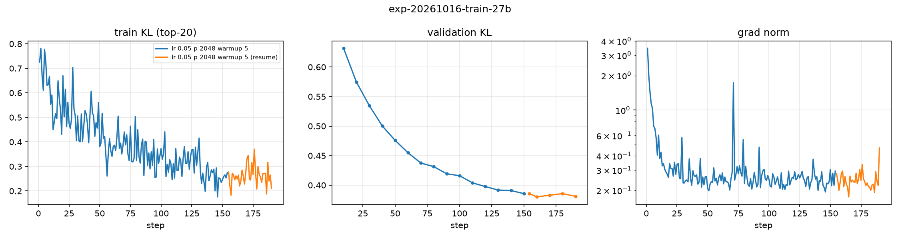

# Cartridges: a whole journal in 0.3 GB

A language model can answer questions about a journal if it reads the journal first.
To read it, the model keeps one key and one value for each token, in each attention layer.
This is the KV cache.
My journal has 714 handwritten pages, about 205,000 tokens.
On Qwen3.8-27B, the cache for this journal is about **13.4 GB**.
The model must build this cache before the first answer, and it must keep the cache for each question.

I replace that cache with a **cartridge**: a small cache that I train.
The cartridge has 2,048 positions and uses about **0.3 GB**. This is about **45× less memory**.
You load the cartridge like a file. The model does not read the journal again.

Think of two students.
The **Teacher** reads the full journal again before each answer.
The **cartridge** is the memory of the journal. It is small, fast and always ready.

## How a cartridge learns

I do not change the weights of the model.
The model stays frozen, and only the cartridge trains.
The cartridge has two parts:

- A key-value prefix of 2,048 positions for each of the 16 attention layers.
- An initial state for each of the 48 linear-attention (Gated DeltaNet) layers.

At step 0, the cartridge is a copy of the cache for the first 2,048 tokens of the journal.
Training then moves this cache so that the model answers as if it had the full journal.

The data comes from four sources:

1. Questions that the author wrote.
2. Real prompts from the author's chat history.
3. Items from psychology tests.
4. Questions that a model wrote from journal pages.

The Teacher is the same frozen model with the full journal in context.
It answers each question and cites pages as `[Journal:p.N]`.
I keep its 20 most probable next tokens at each position. These are the training targets.

Training has two stages.
In stage 1, the cartridge learns from the Teacher's answers.
In stage 2, the cartridge writes its own answers, and the Teacher grades each token.



Interactive version: [`docs/report/diagrams/ml-system.html`](docs/report/diagrams/ml-system.html).

## Training recipe

I give the recipe for the cartridge in two stages.

**Stage 1: distillation from Teacher answers.**
The model reads the Teacher's answer token by token.
At each token, the cartridge learns to give the same next-token probabilities as the Teacher.

| Component | Setting |
|---|---|
| Base model | Qwen3.8-27B, frozen |
| Trainable parameters | Cartridge only: 2,048-position KV prefix (16 layers), initial states (48 layers) |
| Initialization | Cache of the first 2,048 journal tokens |
| Objective | KL(Teacher top-20 ‖ cartridge), per token |
| Optimizer | Adam |
| Learning rate | 5e-2, relative to the size of each tensor |
| Learning-rate sweep | 1e-2, 2e-2, 5e-2, 1e-1 |
| Warmup | 5 steps |
| Batch size | 16 examples |
| Steps | 190 (about 2.9M tokens) |
| Checkpoint selection | Lowest validation KL (step 160) |

*Table 1: Stage 1 configuration.*

**Stage 2: on-policy distillation.**
In stage 1, the cartridge always reads the Teacher's tokens.
At inference, it reads its own tokens.
After one token that the Teacher would not write, the cartridge is in a state that it did not train on.
Stage 2 removes this gap ([Agarwal et al. 2023](https://arxiv.org/abs/2306.13649)).
At each step, the cartridge writes answers.
The Teacher then reads each answer and gives its next-token probabilities at each position.
Each sample comes from the current cartridge, so the loop has no importance ratio and no clipping.
There is no reward for a full answer. The signal is per token.

| Component | Setting |
|---|---|
| Start point | Stage 1 checkpoint |
| On-policy objective | KL(cartridge ‖ Teacher), full vocabulary, per token |
| Anchor objective | Stage 1 loss on stored Teacher answers |
| On-policy fraction (λ) | 0.25 for 10 steps, then 0.5 |
| Batch size | 32. Steps 1–10: 4 questions × 2 samples, plus 24 Teacher answers. Steps 11–30: 8 questions × 2 samples, plus 16 Teacher answers |
| Sampling | Temperature 1, up to 512 new tokens |
| Optimizer | Adam, one step per batch |
| Learning rate | 1e-2, relative to the size of each tensor |
| Steps | 30 |
| Checkpoint selection | Lowest on-policy validation KL (step 20) |

*Table 2: Stage 2 configuration.*

## Results

I compare three systems on 198 held-out questions:
the base model with no journal, the base model with the cartridge, and the Teacher.

| Measure | Base model (no journal) | **Cartridge (0.3 GB)** | Teacher (13.4 GB journal) |
|---|---|---|---|
| Perplexity on the Teacher's answers | 3.61 | **2.09** | 1.34 |
| Top-1 token agrees with the Teacher | 68.7% | **81.3%** | 100% |
| Validation KL to the Teacher (top-20) | 0.82 at init | **0.38** | 0 |

*Table 3: Stage 1 results.*

I report the **context gap closed (CGC)**:

CGC = (NLL_base − NLL_cartridge) / (NLL_base − NLL_teacher).

A value of 1 means "as good as the full journal". A value of 0 means "no better than no journal".
The cartridge gets **CGC = 0.55** (95% CI 0.53–0.58).
It closes **55% of the gap** with **2% of the memory**.

The gap closed is larger on names (0.65) and on dates and numbers (0.65) than on ordinary text (0.54).
Recall of single events is the weakest area (0.25, from 3 questions only).



Training turns the cache vectors 13–32° into new directions. The deep layers move most.
See [`docs/report/figures/cartridge-drift.html`](docs/report/figures/cartridge-drift.html).

Stage 2 decreases the on-policy KL by a third.
The stage 1 metric does not get worse. It improves a little.

| Validation | Stage 1 (step 0) | **Best (step 20)** | Step 30 |
|---|---|---|---|
| On-policy KL: cartridge's own answers, 32 held-out questions | 0.265 | **0.179** (−32%) | 0.182 |
| Teacher-forced KL: Teacher's answers, 64 held-out labels | 0.380 | 0.370 | 0.364 |

*Table 4: Stage 2 results.*

A learning rate of 5e-2 in stage 2 did not work.
The on-policy KL stayed flat, and the teacher-forced KL increased to 0.413.

Stage 1 cost about $26 of GPU time, including labels, the sweep, training and evaluation.
Stage 2 cost $4.07, about 80 s for each step.

I have not yet measured whether the lower KL gives better answers.
A side-by-side comparison with a model judge is in progress.
The design for stage 2 is in [`docs/plans/onpolicy-distill.md`](docs/plans/onpolicy-distill.md).

## Project layout

| Path | What it does |
|---|---|
| `src/cartridges/cli.py` | One Fire CLI for all stages |
| `src/cartridges/training/`, `src/cartridges/serve/` | OCR fine-tuning and the OCR service |
| `src/cartridges/batch/` | PDF → pages → dated timeline |
| `src/cartridges/cartridge/tasks/` | Task Store, sampler, generator, labeling, CGC, judge |
| `src/cartridges/cartridge/teacher.py` | The vLLM Teacher and the shared prompt `render()` |
| `src/cartridges/cartridge/cache.py` | The `Cartridge` module |
| `src/cartridges/cartridge/train_distill.py` | Distillation, sweeps, early stopping |
| `src/cartridges/cartridge/onpolicy.py` | Stage 2: on-policy sampling, Teacher grading, reverse KL, mixed training |
| `src/cartridges/serve/gateway.py` | Chat gateway for LibreChat |
| `docs/ONBOARDING.md` | Guided tour of the code |
| `docs/plans/` | Design documents |

## Quick start

```bash
uv sync
set -a; source .env.local; set +a          # DATABASE_URL, W&B and Modal keys

# Ask the trained cartridge a question (base model + cartridge, no journal in context)
uv run cartridges cartridge_ask "What do I write about most?" cartridge-fedz6mv3:latest

# Measure context gap closed on the eval split
uv run cartridges eval_cgc --cartridge cartridge-fedz6mv3:latest --label_runs <eval label runs>

# Stage 2 from a stage-1 checkpoint (H200; add --dry_run to check the config and cost first)
uv run cartridges cartridge_train --init_cartridge <stage-1 checkpoint> --label_runs <runs> --val_label_runs <runs> \
  --build_data False --grpo_steps 0 --onpolicy_steps 30 --onpolicy_batch_size 32 --onpolicy_lr 0.01 \
  --onpolicy_max_new_tokens 512 --onpolicy_val_n 32 --gpu H200
```

The journal data is private and is not in this repository.

## Prepare data

The `prepare-data` command runs a Prefect flow by default:

```bash
uv run cartridges prepare-data data/journals/inputs/example.pdf data/journals/output/example.md
```

Use the Anthropic agent workflow explicitly when you want the page-by-page agent loop:

```bash
uv run cartridges prepare-data data/journals/inputs/example.pdf data/journals/output/example.md --use-agent
```

The Prefect entrypoint is `src/cartridges/datagen/flows.py:prepare_data_flow`.
For local development, call it through the CLI or from Python. Once the repo is
published to GitHub, deploy it with Prefect Cloud using that entrypoint and the
GitHub source:

```bash
uvx prefect-cloud deploy src/cartridges/datagen/flows.py:prepare_data_flow \
  --from <github-account>/<repo-name> \
  --name prepare-data
```
