# Label queue: keep the Teacher GPU fed

**Status:** proposal, 2026-10-16. **Owners:** datagen (producer, queue, store), teacher (dispatcher, writer, `label_stream`), monitoring (metrics).
**Related:** `docs/plans/task-db.md` (Task Store, Target Store), `src/cartridges/batch/pipeline.py` (the OCR pipeline's bounded-queue pattern, reused here).

## 1. Problem

Measured on the full 27B label run (H200, vLLM V1 with cascade attention, 96 concurrent requests). Sources: vLLM 10 s stats from 20:10 to 20:48 UTC, W&B per-call metrics from service run `9y3ng874`, label timestamps in Neon.

| Measure | Value |
|---|---|
| Share of wall time with ≥ 80 requests running | 11% |
| Share of wall time with 0 requests running | **~55%** |
| Generation rate while ≥ 80 running | 1,455 tok/s (peaks 2.3k) |
| Generation rate averaged over the run | **514 tok/s** |
| One batch cycle (256 tasks) | ~20 s ramp, 100–120 s active, 30–40 s tail, **1.5–2.8 min idle** |
| Time to first token, p50 / p90 | 1.5 s / 4.4 s (prefill is not the bottleneck) |
| Output tokens per answer, mean / p90 | 573 / 880 |

`label()` runs synchronous batches. It samples 256 tasks, waits for the slowest answer, writes the shard, uploads it, inserts the labels, and only then samples again. vLLM does batch continuously inside the container, but the client starves it in two ways:

1. **The drain tail.** As a batch finishes, the requests in flight fall from 96 toward 0, and the GPU decodes a few long answers at low occupancy.
2. **The client gap.** Sampling, the shard write and upload, and the label inserts all run while nothing is in flight.

datagen profiled one 256-task batch on CPU against Neon, with a realistic 28 MB shard:

| Step | Time |
|---|---|
| `generate_all`: 256 serial `.spawn()` calls (167 ms each) | **42.6 s** |
| `generate_all`: 256 serial `.get()` calls | **37.7 s** |
| for comparison, the same 256 calls through `.map` | 3.3 s |
| Volume upload of the shard | 11.7 s |
| label inserts (Neon) | 1.5 s |
| sampler query | 0.8 s |
| shard write, validation, rows | 0.9 s |

**Most of the gap is client RPCs.** `generate_all` (added so an interrupt can cancel calls) issues and collects its calls one at a time. At 167 ms per spawn, filling 96 slots takes about 16 s and queueing all 256 takes about 43 s, while collecting the results takes another 38 s. So the dispatcher in §3.3 must issue and await calls **concurrently**, one asyncio task per request awaiting `.remote.aio`, and the upload must run in the background writer.

## 2. Napkin math

| | Tokens | Time |
|---|---|---|
| Output, full 27B run (~3,100 answers × ~570) | ~1.75M | |
| Ideal: ~1.4k tok/s sustained at full occupancy | | **~21 min** |
| Actual: 514 tok/s effective | | ~57 min |

The fix only needs the GPU to stay at the busy-phase rate. Every completion has to be replaced within one decode step, and no I/O can sit on the request path.

## 3. Design



Interactive version: [`diagrams/label-queue.html`](diagrams/label-queue.html).

| Component | Runs on | Job |
|---|---|---|
| **Producer** | CPU (host or a separate process) | Samples tasks from the Task Store with the origin and kind mix, and enqueues them as jobs. It stays at least 2× the window ahead of the dispatcher. |
| **Job queue** | Postgres `cartridge.label_jobs` | A durable, ordered work list. Workers claim jobs with `FOR UPDATE SKIP LOCKED`, under a lease. A `priority` column replaces phase ordering. |
| **Dispatcher** (new) | Host, asyncio | Keeps a fixed **window W** of requests in flight on the Teacher. Every completion frees a credit, and the dispatcher immediately submits the next claimed job. |
| **Teacher** | Modal H200, vLLM | Unchanged. It batches continuously over up to 128 sequences. |
| **Result writer** | Host, background task | Buffers completions and flushes every 256 rows or 30 s. Each flush writes a Parquet shard to the Volume, then commits labels plus job acknowledgements in one transaction. |
| **Task Store / Target Store** | Postgres / Modal Volume | Unchanged schemas. Labels keep their unique key (task, teacher, corpus, instructions hash). |

### 3.1 What "the GPU is available" means

The proposal dispatches a new batch once the GPU is free. Dispatching **per request, not per batch**, fixes both causes in §1:

- A per-batch trigger brings back the drain tail: the GPU is only "free" once the last long answer finishes.
- vLLM admits a waiting request at the next decode step, so the host should keep a few requests already waiting at all times.

The rule is: **available = in-flight < W**, with `W = max_num_seqs + headroom`, for example 128 + 32 = 160. With 32 requests always waiting inside vLLM, a freed slot is refilled within one step (tens of milliseconds). That needs no extra round trip from the host.

| Signal | Source | Use |
|---|---|---|
| Requests in flight (primary) | the dispatcher's own counter: +1 on submit, −1 on completion | gates every submit; exact and immediate |
| vLLM running, waiting, KV use | `Teacher.stats()` polled every 5 s (wraps the existing `do_log_stats` loop) | adapts W: grow it by 16 while waiting is 0 and KV is below 70%; shrink it if vLLM reports preemption |
| Queue depth | `count(*) where status='queued'` every 10 s | tells the producer to top up when depth < 2W |

Modal's per-container concurrency (`max_inputs`) must be at least W. Otherwise the waiting requests queue in Modal instead of in vLLM, and each one pays an extra network round trip.

### 3.2 Queue schema

```sql
CREATE TABLE IF NOT EXISTS cartridge.label_jobs (
    job_id            UUID PRIMARY KEY,
    task_id           UUID NOT NULL REFERENCES cartridge.tasks(task_id),
    teacher_model     TEXT NOT NULL,
    corpus_id         TEXT NOT NULL,
    instructions_hash TEXT NOT NULL,
    split             TEXT NOT NULL,
    priority          INT  NOT NULL DEFAULT 0,          -- lower runs first (train:chat=0 ... eval:human=5)
    status            TEXT NOT NULL DEFAULT 'queued'
                      CHECK (status IN ('queued', 'leased', 'done', 'failed')),
    lease_owner       TEXT,                              -- host id
    lease_until       TIMESTAMPTZ,
    attempts          INT  NOT NULL DEFAULT 0,
    label_id          UUID,                              -- set on done
    last_error        TEXT,
    enqueued_at       TIMESTAMPTZ NOT NULL DEFAULT now(),
    UNIQUE (task_id, teacher_model, corpus_id, instructions_hash)   -- one job per label key
);
CREATE INDEX IF NOT EXISTS label_jobs_claim ON cartridge.label_jobs (status, priority, enqueued_at);
```

**Claim** takes one round trip per 64 jobs:

```sql
UPDATE cartridge.label_jobs SET status='leased', lease_owner=%s,
       lease_until=now() + interval '10 minutes', attempts=attempts+1
WHERE job_id IN (SELECT job_id FROM cartridge.label_jobs
                 WHERE status='queued' OR (status='leased' AND lease_until < now())
                 ORDER BY priority, enqueued_at
                 LIMIT 64 FOR UPDATE SKIP LOCKED)
RETURNING job_id, task_id;
```

**Ack** commits in the same transaction as the label insert, so a crash can't record one without the other:

```sql
-- after the shard upload succeeds
COPY cartridge.labels FROM STDIN ...;                     -- ON CONFLICT via staging table
UPDATE cartridge.label_jobs SET status='done', label_id=... WHERE job_id = ANY(%s);
```

### 3.3 Dispatcher loop

```python
async def dispatch(teacher, queue, writer, W):
    inflight: set[asyncio.Task] = set()
    ready: deque[Job] = deque()
    while True:
        if len(ready) < W:                                  # keep a claimed buffer ahead
            ready.extend(await queue.claim(n=64))
        while ready and len(inflight) < W:                  # "GPU available"
            job = ready.popleft()
            inflight.add(asyncio.create_task(teacher.generate.remote.aio(job)))  # concurrent RPC, never serial
        if not inflight and not ready:
            break                                           # queue drained
        done, inflight = await asyncio.wait(inflight, return_when=FIRST_COMPLETED)
        for t in done:
            writer.put(t.result())                          # never blocks: bounded buffer, background flush
```

Only one tail remains: the one at the very end of the whole job, not one per batch.

### 3.4 Failure handling

| Failure | What happens |
|---|---|
| Host crashes | Its leases expire after 10 min and other hosts or a rerun reclaim the jobs. Labels already committed stay. The unique label key stops duplicates. |
| GPU container is preempted | In-flight calls fail. The dispatcher puts those jobs back (`status='queued'`); others refill the window once the new container is up. |
| Shard upload fails | That flush doesn't commit, the jobs stay leased, and the next flush retries. Labels never point at a shard that doesn't exist. |
| A job fails 3 times | `status='failed'` with `last_error`. It's reported, not retried forever. |
| Ctrl-C | In-flight calls are cancelled (`generate_all` behaviour), the buffer is flushed, and leases are released. |

## 4. Expected effect

| Measure | Now | Target |
|---|---|---|
| Time with 0 requests running | ~55% | < 5% (one cold start, one final tail) |
| Effective generation rate | 514 tok/s | 1.2–1.5k tok/s |
| Full 27B label job (~1.75M tokens) | ~57 min, $4.84 | **~20–25 min, ~$2** |
| Gap between batches | 1.5–2.8 min | none |

These are estimates from the busy-phase rate. The acceptance check in §6 measures them.

**First measurement (2026-10-16, relabel run, concurrent `generate_all` plus streaming `label_stream`, no Postgres queue yet).** The large phase was 628 psych tasks:
- the window ramped to 120 requests in flight within ~30 s;
- it then held 106–120 requests at 2.3–3.6k tok/s for ~2 min, with no gaps inside the phase;
- the result was **~1.4k tok/s effective, 2.7× the 514 tok/s baseline**.

The run as a whole was still idle 48% of the time, from phase boundaries (each phase re-samples and opens new runs) and two tiny phases (33 and 8 tasks) that were all tail. Next step: one streaming phase across origins and splits, so the window never drains at a phase boundary. The durable queue in §3.2 gives this by design.

## 5. Implementation plan

| # | Step | Owner | Verify |
|---|---|---|---|
| 1 | `label_jobs` DDL in `store.SCHEMA`, idempotent; `enqueue_jobs`, `claim_jobs`, `release_jobs`, `ack_jobs` in `store.py` | datagen | local-Postgres tests: two concurrent claimers never get the same job; an expired lease is reclaimed; ack and labels commit together |
| 2 | Producer: `tasks_enqueue_labels --teacher --split --origins --priority` (reuses the sampler and origin mix) | datagen | enqueueing twice adds 0 rows; the priority order matches the phases |
| 3 | Dispatcher: credit window over `teacher.generate_all` spawn handles; W from config; adaptive W from `Teacher.stats()` | teacher | fake Teacher with variable latency: in-flight stays at W while jobs remain; no barrier |
| 4 | Result writer: bounded buffer; flush on N rows or T seconds; shard upload, then one transaction for labels and job acks | teacher | fake Volume and DB: an upload failure leaves jobs leased and no labels; a crash mid-flush leaves no orphans |
| 5 | `Teacher.stats()` method returning running, waiting, KV use and gen tok/s | teacher | unit test on the parsed stats; redeploy only when no session is running |
| 6 | `tasks_label --queue` runs producer, dispatcher and writer in one session; the old batch path stays for one release | datagen | end-to-end CLI test with fakes |
| 7 | Metrics to W&B every 10 s: `queue/depth`, `dispatch/inflight`, `vllm/running`, `vllm/waiting`, `gpu/busy_frac`, `gen/tok_s`, `writer/flush_s`; add a W&B report panel | monitoring | panel shows `gpu/busy_frac` on the next run |
| 8 | Pilot: relabel or label 500 psych tasks with `--queue` on H200 at max_inputs 160 | datagen + teacher | busy ≥ 85% of wall time after warm-up, effective ≥ 1.2k tok/s, no duplicate labels |

Steps 1–7 are CPU-only. Step 8 is one GPU session, about $0.5.

## 6. Acceptance criteria

- `gpu/busy_frac` (≥ 80 requests running) stays at or above 85% between the first completion and the final tail.
- No interval longer than 5 s with 0 running, except the cold start and the final tail.
- Effective generation rate is at least 1.2k tok/s on the pilot.
- After the run: label count = done job count, no orphaned shards, and no duplicate label keys.

## 7. Alternatives considered

- **In-memory sliding window only** (teacher's `label_stream`, in progress). It gets most of the throughput gain with less code, but it isn't durable across host crashes, can't share work between hosts, and can't resume without re-sampling. The queue adds those for one table and four store functions. The dispatcher and writer are the same either way, so `label_stream` becomes the dispatcher in step 3.
- **Larger vLLM `max_num_batched_tokens`.** Prefill isn't the bottleneck (TTFT p50 1.5 s), so the expected gain is ≤ 5–10%, and it would need a redeploy. Not now.
- **More GPUs.** Only worth it after one GPU is kept busy. The queue already supports several hosts or containers claiming jobs.

## 8. Open questions

1. Should the producer run inside the label session or as a separate scheduled step? Proposal: inside, with an option to enqueue ahead.
2. Should the eval-scoring passes (CGC, the judge) use the same queue? They have the same shape: many independent requests to one GPU service.
